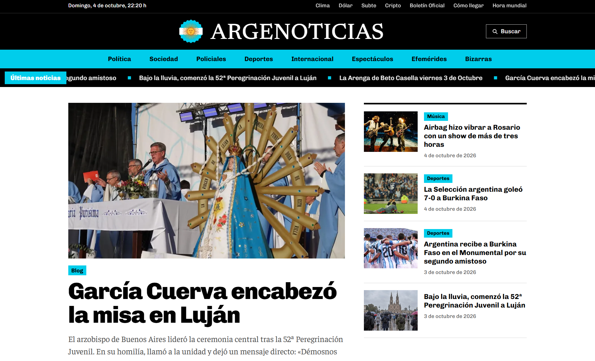
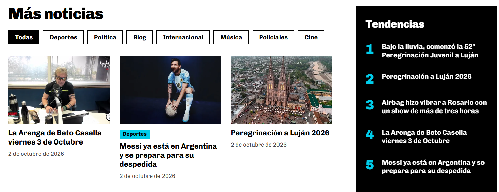
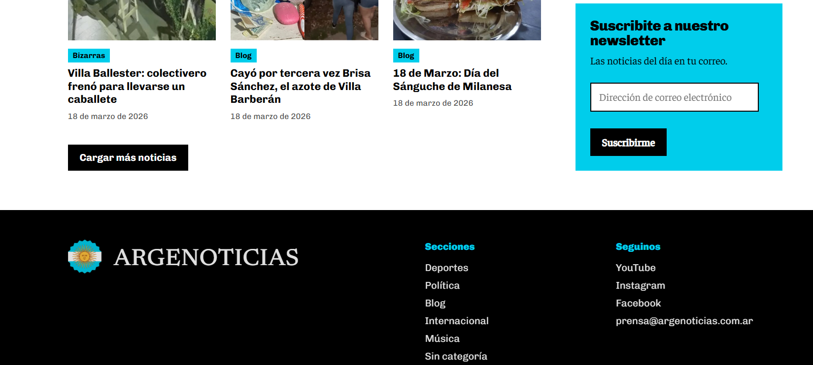

# Argenoticias Theme

Custom WordPress theme for [argenoticias.com.ar](https://argenoticias.com.ar), an Argentine digital news outlet. It replaces a stock block theme with a design built around the outlet's own identity: its logo, its light blue, and a layout made for scanning headlines.

## Overview

A classic PHP theme with no page builder and no plugin dependencies. Existing posts, categories and images are untouched: the theme only changes how they are presented.

I defined the brief, the visual identity and every design decision, and implemented the theme through AI-assisted development with Claude, iterating on live previews until each part was approved, then deploying it to the production site.

## Features

- Front page with a lead story, four secondary stories and a card grid
- Latest news ticker built from the six most recent posts, paused on hover and disabled for reduced-motion users
- Section filter and load-more on the front page through the WordPress REST API, with plain links as a fallback when JavaScript or the API is unavailable
- Trending block ranked by Jetpack Stats views, falling back to most commented and most recent posts, cached for an hour
- Article template with featured image, reading typography, share links and related stories from the same section
- Section, tag, search, archive and 404 templates with pagination
- Sections nav in a fixed editorial order that hides empty categories
- Utility bar with live Buenos Aires date and time and quick links
- Newsletter block wired to the site's existing Jetpack subscriptions
- Admin notice when published posts are left without a section
- Responsive layout, keyboard focus styles and skip link

## Design

- Palette: black, white and the light blue taken from the outlet's logo
- Typefaces: Newsreader for the wordmark, Chivo for headlines and interface, Faustina for reading text

## Content migration

Alongside the redesign, 147 legacy posts filed under the default category were reorganized into an eight-section scheme. I exported the posts, classified each one with AI assistance, reviewed the result in a spreadsheet, and applied it in bulk with a one-off admin tool that showed every change before running. The tool was removed from the theme once the migration was done.

## Tech Stack

- WordPress (classic theme, no parent theme)
- PHP templates and template tags
- Vanilla JavaScript, no dependencies
- CSS with custom properties
- WordPress REST API and Jetpack (stats, subscriptions)
- Hosted on WordPress.com

## Structure

```
theme/
  style.css                   Theme header and all styles
  functions.php               Setup, assets, template tags, trending logic
  header.php / footer.php     Site chrome, sections nav, ticker
  front-page.php              Front page layout
  single.php / page.php       Article and static page
  index.php                   Listings: sections, tags, search, archives
  template-parts/listado.php  Shared listing markup
  comments.php / searchform.php / 404.php
  assets/js/main.js           Clock, search toggle, filter and load-more
  assets/img/                 Logo
```

## Setup

1. Zip the `theme` folder and upload it in WordPress under Appearance > Themes.
2. Preview it, then activate it.
3. Optionally assign a menu to the "Secciones" location. Without one, the nav lists the sections in the theme's editorial order.

## Live Site

[argenoticias.com.ar](https://argenoticias.com.ar)

## Preview






